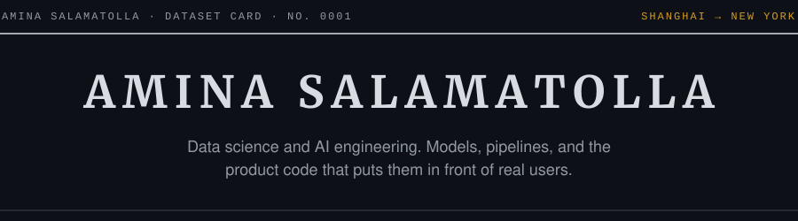

<picture>
  <source media="(prefers-color-scheme: dark)" srcset="assets/header-dark.svg">
  <source media="(prefers-color-scheme: light)" srcset="assets/header-light.svg">
  
</picture>

Data Science with an AI concentration at New York University, class of 2028. NYU Shanghai is my home campus, and I'm spending this year in New York. Most of my recent work sits where data meets product: a production clinic portal on Next.js and Supabase, and an enterprise SharePoint system that turns legacy process documents into live, permissioned workflows. I'm most interested in applied ML, data systems, and quantitative problems.

[as20312@nyu.edu](mailto:as20312@nyu.edu) · [github.com/amina-sb](https://github.com/amina-sb)

## Experience

<table>
  <tr>
    <th align="left">Date</th>
    <th align="left">Role</th>
  </tr>
  <tr>
    <td valign="top">May 2026 – now Remote</td>
    <td>
      <a href="https://app.aidencare.space"><b>AidenCare</b></a> · AI &amp; Data Engineering Intern 
      Patient portal and staff dashboard for dental clinics, built by a three-person engineering team on Next.js, React 19, TypeScript and Supabase Postgres. Took the platform from repository to production: Vercel CI/CD, custom-domain DNS, and Git identity and GitHub organization access for the team.
    </td>
  </tr>
  <tr>
    <td valign="top">2026 Remote</td>
    <td>
      <b>NCOC</b> · Full-Stack Developer, HSSE Platform 
      Health, safety and environment management system for an energy operator, built on SharePoint Online with SPFx and React. Built most of the application through release v2.13.3: parsers that turn Visio (VSDX) and Word (DOCX) process documents into BPMN-style swimlane flowcharts in the browser, PDF export, and admin features gated by SharePoint permissions.
    </td>
  </tr>
</table>

## Stack

**Languages** · Python, TypeScript, JavaScript, SQL 
**Data and ML** · pandas, NumPy, scikit-learn, PyTorch, Jupyter 
**Product** · Next.js, React, Tailwind CSS, SPFx / SharePoint 
**Infrastructure** · Supabase, PostgreSQL, Vercel, Git
